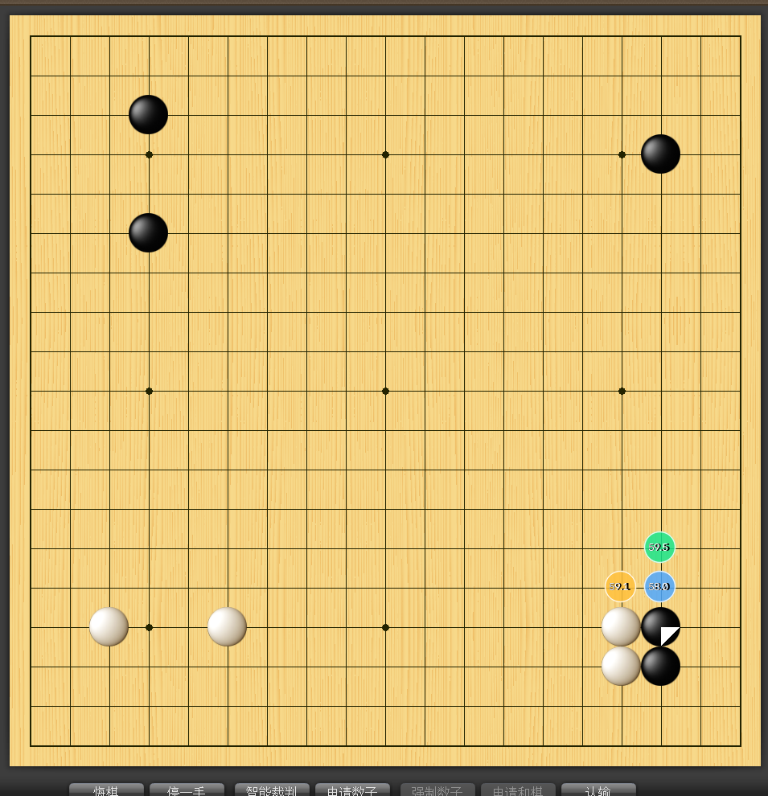

# fox-ai-marker

Real-time KataGo candidate-point overlay for **Fox Weiqi (野狐围棋)** on Windows.
Watches the Fox client window, reads the board off the screen, asks KataGo for the top
moves, and paints the top 3 candidates on the board in different colours. It never
places stones, never injects clicks, and never touches the Fox client's files.



---

## 野狐围棋 · KataGo 实时候选点标注

看着野狐的棋盘，用 KataGo 算，把 AI 觉得最好的几个点**用不同颜色直接画在棋盘上**。

不落子、不摆变化图、不碰野狐的任何文件。就是一个贴在野狐窗口上的透明图层。

### 它做什么

- 每 0.3 秒截一次野狐窗口，识别 19 路棋盘上的黑白子
- 每落一手问一次 KataGo：轮到谁、最该下哪
- 在棋盘上标出前三个候选点：**绿 = 一选，黄 = 二选，蓝 = 三选**
- 一选与二选胜率差 ≥ 1.5 个点时只标一选（差距太大，摆三个反而干扰）
- 野狐切后台 / 最小化 / 不在对局页时，标注自动消失
- 鼠标完全穿透，不影响正常操作

### 它不做什么

- 不自动落子，不模拟点击
- 不摆后续变化图
- 不改野狐的配置、缓存、棋谱

---

## 装

### 1. Python 依赖

```powershell
pip install -r requirements.txt
```

需要：`numpy`、`opencv-python`、`PySide6`、`pywin32`、`Pillow`。

### 2. 引擎和权重

仓库里**不带**二进制（KataGo 引擎约 15 MB，权重 250 MB，放 Git 里不合适）。
用一条命令下到项目目录里：

```powershell
powershell -ExecutionPolicy Bypass -File scripts\setup.ps1
```

它会下载：

| 东西 | 来源 | 大小 |
| --- | --- | --- |
| KataGo **v1.16.5** (OpenCL, win64) | [KataGo releases](https://github.com/lightvector/KataGo/releases) | 4.6 MB |
| 权重 `b18c384nbt-uec` | [KataGo releases](https://github.com/lightvector/KataGo/releases/tag/v1.12.4) | 93 MB |

都解到 `katago\` 和 `weights\`，程序会自动找到。

> 也可以手动下：把 `katago.exe` 和一票 DLL 放进 `katago\`，
> 把 `*.bin.gz` 放进 `weights\`。

#### 关于权重版本

- **用了 b18c384nbt**：v1.16.5 能读、且在这类显卡上最快的一组。
- **没用最新的 tf3 网络**（`kata1-tf3-b11c768`，250 MB）：它是 model version 17，
  v1.16.5 直接报 `This neural net requires a newer KataGo version`。
  KataGo 目前还没发支持 v17 的正式版，等发了再换。
- 想要更强可以手动换 `weights\` 里的权重，`config.json` 的 `katago_model` 指过去即可。
  实测（MX250 / 400 visits / 每手热身后）：

  | 权重 | 加载 | 每手 | 备注 |
  | --- | --- | --- | --- |
  | b18c384nbt-uec（默认） | 2.8s | **0.43s** | 实时够用 |
  | b20c256x2（2020 年的老网络） | 2.7s | 1.17s | 又慢又弱，不建议 |
  | b28c512nbt | 128s | 2.08s | 最强，但每手 2 秒 |

---

## 用

先开野狐，进到**对局页**（棋盘能看见），然后：

```powershell
python run.py
```

或者双击 `启动.bat`。

会弹出一个小面板（左上角），棋盘上的彩色圆点就是 AI 的意见。

- 面板 **暂停**：停下来自己静静下
- 面板 **重新找棋盘**：丢掉缓存的棋盘位置，重新识别
- 面板 **退出**：关掉引擎和标注

第一次启动要等十几秒（加载引擎 3 秒 + GPU 首次推理预热，程序会自己先空算一手）。
之后每手 0.4 秒左右。

---

## 配置（config.json）

第一次运行会在同目录生成，改完重启程序生效。

| 键 | 默认 | 说明 |
| --- | --- | --- |
| `max_visits` | 400 | 每手分析多少 visits。越小越快、越不准则调大 |
| `capture_interval_ms` | 300 | 多久看一次棋盘 |
| `show_candidates` | 3 | 最多标几个点 |
| `winrate_gap_1stone` | 1.5 | 一选与二选胜率差（百分点）≥ 这个值 → 只标一选 |
| `winrate_gap_2stone` | 3.0 | 二选与三选胜率差 ≥ 这个值 → 不标三选 |
| `colors` | 绿/黄/蓝 | 三个候选点的颜色（hex） |
| `dot_radius_ratio` | 0.40 | 点半径 = 0.40 格 |
| `show_winrate_text` | true | 点上写不写胜率数字 |
| `show_status` | false | 棋盘左上角那行状态小字 |
| `overlay_hide_when_other` | true | 野狐不在前台时隐藏标注 |
| `manual_board` | null | 手动校准的棋盘矩形 |
| `katago_model` | 自动找 | 换权重就指到这里 |

---

## 识别不准怎么办

程序自己找棋盘，绝大多数情况不用管。如果一直标不到点、或者状态显示"没看到棋盘"：

```powershell
python tools\calibrate.py
```

会弹出野狐截图，点两下——先点**左上角那个交叉点**，再点**右下角那个交叉点**。
它当场用你框的位置试读一遍，读出棋子数量后按"保存"，写进 `config.json`。

注意：野狐窗口**大小变了要重新校准**。

---

## 它是怎么做到的

1. **截图**：`PrintWindow` 直接从野狐窗口渲染，不需要野狐在前台，也不会把自己的标注截进去
2. **找棋盘**：以窗口里的众数颜色为种子找最大的同色矩形；再在矩形里扫描 `(起点, 格宽)`，
   让 19 条网格线的暗度总和最大 —— 换皮肤、改窗口大小都能自适应
3. **对齐网格**：野狐的网格线只有 1~2 像素宽，按单像素采样会差一格，
   所以每个采样点取 ±2px 内的最大值
4. **判黑白**：每个交叉点取半径 0.18~0.34 格的一圈像素（避开子中心的"最后一手"标记、也避开网格线）。
   野狐的木纹底比白子还亮（实测亮度 201 vs 204），所以**不能只看亮度**：
   彩色底看饱和度（白子是中性灰），中性底看亮度
5. **分析**：走 KataGo 的 `analysis` 引擎（不是 GTP），一次请求丢一个完整局面进去
6. **画点**：一个无边框、置顶、点击穿透的透明窗口，贴在野狐窗口上画圆

---

## 常见问题

**标出来的点位置偏了**
多半是 DPI 缩放。程序已声明 per-monitor DPI 感知；改过 Windows 缩放比例后要重启程序。

**白子被认成空点 / 空点被认成白子**
换皮肤导致的。跑 `tools\calibrate.py`，或者调 `color_tolerance`（40~80）。

**每手都要等一两秒**
`max_visits` 调小（150~200），或者换小一点的权重（b18c384nbt 比 tf3 快很多）。

**引擎起不来**
看面板下面的报错。常见：权重路径变了、显存不够、显卡驱动更新后 OpenCL 需要重新调优
（第一次会慢 3 分钟，之后正常）。

**野狐不在前台就不标了**
故意的（`overlay_hide_when_other`）。想让它后台也标，改成 `false`。

---

## Credits

- [KataGo](https://github.com/lightvector/KataGo) — 引擎和权重（MIT / 各自许可证）
- 野狐围棋客户端 — 只读取窗口像素，不修改任何文件

本项目只做"看屏幕 + 画图层"，不参与对局操作。用它下棋记得看野狐的用户协议。

## License

MIT
