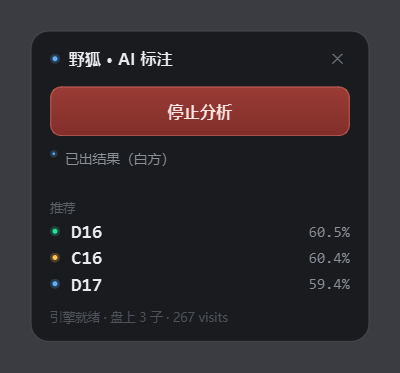

# fox-ai-marker

在野狐围棋的棋盘上标出 KataGo 觉得值得下的几个点。

> ## ⚠️ 先说清楚
>
> **它不会替你落子。** 不注入点击、不模拟鼠标键盘、不自动下棋、不操作野狐窗口里的任何东西。
> 只做两件事：读屏幕上的棋盘像素，在一个透明图层上画几个圆点。
>
> **在线对局中使用它是作弊。** 技术上它不会拦你，但项目不支持这么用，也不做任何
> 隐藏或规避检测的处理。拿它去赢棋，后果（包括账号处理）自负。
>
> **它想做的是复盘和学习工具**：和 AI 对照着看你自己的棋，看懂它为什么选这个点。


---

## 它做什么

打开野狐，进到对局页，点一下面板上的「开始分析」。

- 读屏幕上的棋盘，知道现在是第几手、该谁走
- 问 KataGo，在棋盘上标出**前三个候选点**：青绿一选、琥珀二选、天蓝三选，圆里写胜率
- 一选和二选胜率差得多时，只标一选（差太远，摆三个反而干扰）
- 每落一手自动更新，零点几秒就出新的点

| 待机 | 分析中 |
| --- | --- |
|  |  |

## 它不做什么

- **不落子**，不点棋盘，不碰野狐的任何数据和配置
- 不摆后续变化图（只给"这一步下哪"，不给你看十步之后）
- 不帮你赢棋。它给的是 AI 的想法，不是保证正确的答案

---

## 什么时候用它

| 场景 | 合适吗 |
| --- | --- |
| 复盘自己的对局，看哪几步亏了 | ✅ 最合适 |
| 研究一个局部的正确下法 | ✅ |
| 学 AI 的思路，对照自己的判断 | ✅ |
| 给人讲棋、做教学演示 | ✅ |
| 死活题、定式练习时对照 | ✅ |
| 在线对局里当提示器 | ❌ 作弊 |
| 比赛、排位、带彩头的对局 | ❌ 作弊，且很可能违反野狐用户协议 |

一句话：**下完再看，别看下**。

---

## 怎么装

装一次。

1. **Python 依赖**

   ```powershell
   pip install -r requirements.txt
   ```

2. **引擎和权重**（约 100 MB，仓库里不带）

   ```powershell
   powershell -ExecutionPolicy Bypass -File scripts\setup.ps1
   ```

   手动装也行：
   - [KataGo v1.16.5 Windows OpenCL 版](https://github.com/lightvector/KataGo/releases/tag/v1.16.5)，`katago.exe` 和那些 `.dll` 放进 `katago\`
   - [b18c384nbt 权重](https://github.com/lightvector/KataGo/releases/tag/v1.12.4)，放进 `weights\`

---

## 怎么用

1. 打开野狐，进到**对局页**（能看见棋盘）
2. 双击 `启动.bat`（或 `python run.py`）
3. 把野狐窗口放到前面，点面板上的 **开始分析**

之后不用管了，落一手棋盘上就出点。

- 面板可以按住拖动，默认在屏幕右上角
- **停止分析** 清掉标注并停止，右上角 ✕ 直接退出
- 野狐切到后台时标注自动隐藏，切回来立刻出现
- 野狐关了、窗口尺寸变了，程序会自己停或自己重找棋盘

第一次启动等几秒（引擎加载），第一手约 2 秒（GPU 首次推理），之后每手 100 毫秒内。

**复盘时怎么用**：对局结束后，在野狐里点开这盘的回放，一手一手往回翻。
每翻一手，标注就跟着更新一次 —— 这就是看"当时 AI 觉得该下哪、实际下在哪"最快的办法。

---

## 想调点什么

第一次运行会生成 `config.json`，改完重启生效。

| 键 | 默认 | 说明 |
| --- | --- | --- |
| `max_visits` | 120 | 每手算多深。嫌不够准就调大，但会更慢 |
| `show_candidates` | 3 | 最多标几个点 |
| `dot_radius_ratio` | 0.38 | 圆点大小 |
| `colors` | 青绿/琥珀/天蓝 | 三个点的颜色（hex） |
| `winrate_gap_1stone` | 1.5 | 一选二选胜率差 ≥ 这个值（百分点）就只标一选 |
| `capture_interval_ms` | 150 | 多久看一次棋盘 |
| `overlay_hide_when_other` | true | 野狐不在前台时隐藏标注 |

换权重：把 `*.bin.gz` 丢进 `weights\`，改 `config.json` 里的 `katago_model`。

---

## 标不到点怎么办

程序自己找棋盘，一般不用管。状态一直显示"没看到棋盘"时：

```powershell
python tools\calibrate.py
```

会弹出野狐截图，先点**左上角那个交叉点**，再点**右下角那个交叉点**，读出棋子数后保存。
野狐窗口大小变了要重新校准。

---

## 常见问题

**第一手慢**
GPU 第一次推理要两秒左右，之后就快了。

**每手都要等好几秒**
`max_visits` 调小（80 左右），或者换个小点的权重。

**白子被认成空点**
换皮肤导致的，跑一次 `tools\calibrate.py`。

**CPU / 风扇一直转**
说明引擎在满负荷算。调小 `max_visits`，或者点「停止分析」。

---

## 大致原理

1. 从野狐窗口截一块图（只截棋盘那块，13 毫秒左右）
2. 找出 19×19 网格，在每个交叉点采样，判黑 / 白 / 空
3. 局面变了就问 KataGo，每 0.2 秒收一次中间结果
4. 收到就画 —— 先画出来，后面算得更准了再挪位置
5. 画在一个置顶、点击穿透的透明窗口上，鼠标直接穿过去

整个过程只读像素、只画图层，碰不到野狐的任何数据和操作。

---

## Credits

- [KataGo](https://github.com/lightvector/KataGo) —— 引擎与权重
- [LizzieYzy](https://github.com/yzyray/lizzieyzy) —— 判子思路参考了它的 readboard

## License

MIT
